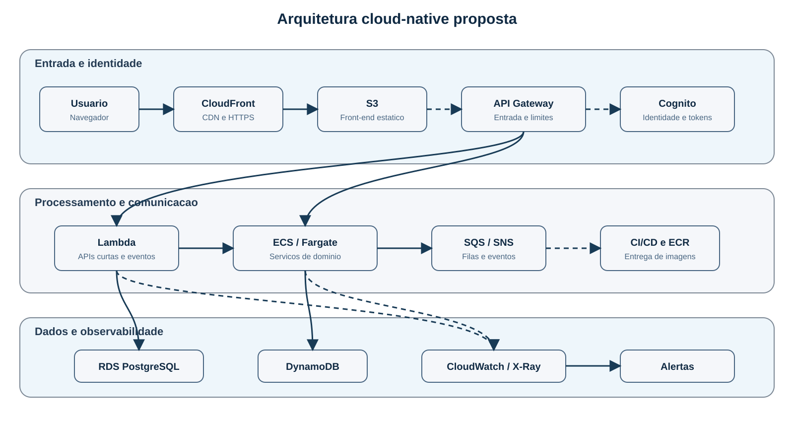

# Arquitetura Cloud-Native para Sistemas Escaláveis: integração de microsserviços, serverless e observabilidade

## Cloud-Native Architecture for Scalable Systems: Integrating Microservices, Serverless Computing, and Observability

<!-- Os nomes, instituições, países, biografias e ORCID devem ser inseridos nos metadados da submissão. -->

## RESUMO

Propõe-se uma arquitetura cloud-native para sistemas escaláveis, combinando microsserviços, serverless, contêineres, persistência poliglota e observabilidade. O estudo é exploratório e apresenta decisões arquiteturais e um plano de validação, sem resultados experimentais.

**Palavras-chave:** Elasticidade; Gestão de custos; Persistência poliglota; Sistemas distribuídos; Tolerância a falhas.

## ABSTRACT

This paper proposes a cloud-native architecture for scalable systems combining microservices, serverless, containers, polyglot persistence, and observability. The exploratory study presents architectural decisions and a validation plan, without experimental results.

**Keywords:** Cost management; Distributed systems; Elasticity; Fault tolerance; Polyglot persistence.

## 1 INTRODUÇÃO

A expansão de serviços digitais exige sistemas que suportem variações de carga, integração entre componentes e evolução frequente. A adoção de nuvem não garante essas propriedades: elas dependem de decisões sobre fronteiras dos serviços, comunicação, dados e operação. A literatura associa microsserviços à evolução independente, mas também registra custos de integração, testes e observabilidade distribuída (Newman, 2021; Di Francesco et al., 2019).

O problema investigado é como estruturar uma arquitetura em nuvem que favoreça evolução e escalabilidade sem transferir complexidade excessiva para operação, segurança e monitoramento. O objetivo é propor uma solução cloud-native que relacione requisitos não funcionais a componentes, responsabilidades e tecnologias, combinando execução serverless e em contêineres, comunicação assíncrona, persistência, segurança e observabilidade.

A diferença em relação a uma arquitetura cloud-native apresentada apenas como catálogo de serviços está no vínculo explícito entre requisito, decisão e verificação. A proposta combina execução híbrida, persistência poliglota, comunicação assíncrona e telemetria em uma matriz que também define condições de teste e critérios de aceitação. Essa integração procura tornar verificável a escolha tecnológica, em vez de presumir que a adoção de serviços gerenciados produz, por si só, escalabilidade ou resiliência.

A questão de pesquisa é: em uma aplicação web com operações síncronas e assíncronas, como uma arquitetura híbrida de Lambda e ECS/Fargate, apoiada por SQS/SNS e persistência RDS/DynamoDB, pode atender metas de latência, taxa de erro, tempo de fila e custo sob carga nominal, pico e falhas controladas? A pesquisa é aplicada, exploratória e ainda está em fase de modelagem. Assim, o manuscrito apresenta decisões e plano de validação, sem afirmar resultados de desempenho, disponibilidade ou economia que não foram medidos.

## 2 METODOLOGIA

O estudo combina levantamento bibliográfico exploratório, análise documental dos artefatos do projeto e modelagem arquitetural. A busca bibliográfica consultou a ACM Digital Library, a ScienceDirect e o arXiv, complementada por documentação oficial da AWS e por livro técnico. Foram consideradas publicações de 2017 a 2023 sobre microsserviços, serverless, contêineres, segurança, observabilidade e arquitetura em nuvem. Foram incluídos trabalhos científicos, livros e documentação técnica com relação direta ao problema e descrição suficiente de benefícios, limitações ou condições de uso; foram excluídas duplicatas, textos sem aderência ao tema e materiais opinativos sem detalhamento técnico. A revisão foi exploratória, não sistemática, e esse recorte limita a generalização dos achados.

Os objetivos foram relacionados aos requisitos de escalabilidade, disponibilidade, manutenibilidade, segurança, observabilidade e custo. Em seguida, esses requisitos orientaram a definição de componentes, responsabilidades, fluxos síncronos e assíncronos, limites de confiança e alternativas tecnológicas. O resultado foi registrado no diagrama arquitetural, na descrição textual e na matriz de decisões do repositório. Para manter a análise rastreável, cada requisito recebeu uma métrica, uma condição de teste e um critério de aceitação preliminar.

A verificação desta etapa é documental. Não foram implementados protótipo, testes de carga ou experimentos com usuários; portanto, a ausência de dados impede conclusões empíricas. A validação futura deverá medir latência, throughput, taxa de erro, comportamento sob falhas, tempo de fila e custo em cenários controlados. A revisão não sistemática e a escolha inicial de serviços AWS também limitam a generalização da proposta.

## 3 REFERENCIAL TEÓRICO

### 3.1 Microsserviços e fronteiras de responsabilidade

Microsserviços organizam uma aplicação em serviços com responsabilidades delimitadas e possibilidade de implantação independente. As fronteiras devem refletir capacidades do domínio, evitando distribuir um monólito sem reduzir o acoplamento (Newman, 2021). Um mapeamento sistemático aponta benefícios de evolução e escalabilidade seletivas, acompanhados de desafios de integração, testes e observabilidade (Di Francesco et al., 2019). A proposta usa responsabilidade de negócio e estabilidade de interfaces para decidir a divisão dos componentes.

### 3.2 Computação serverless e contêineres

Serverless delega ao provedor parte da infraestrutura e executa funções sob demanda. Revisões descrevem adequação a eventos e cargas variáveis, mas também limitações de inicialização, duração, depuração, portabilidade e dependência do provedor (Shafiei et al., 2019; John & Gupta, 2021; Li et al., 2021; Wen et al., 2022). Uma análise de cargas reais de FaaS mostra que frequência de invocação e cold starts afetam diretamente o gerenciamento de recursos (Shahrad et al., 2020). Estudos sobre impacto econômico e carregamento de contêineres indicam que o modelo deve ser escolhido conforme o perfil de cada componente (Adzic & Chatley, 2017; Brooker et al., 2023). Por isso, a arquitetura adota um modelo híbrido, com Lambda para tarefas curtas e contêineres para serviços que exigem maior controle do runtime.

### 3.3 Segurança, observabilidade e operação

Filas e tópicos podem reduzir dependências temporais e absorver variações de demanda, desde que sejam tratados duplicidade, idempotência, retentativas e mensagens não processáveis. Em sistemas distribuídos, autenticação, autorização, criptografia, isolamento, logs, métricas e rastreamento devem acompanhar os fluxos desde o desenho (Indrasiri & Siriwardena, 2020; AWS, n.d.-e). Logs estruturados permitem reconstruir execuções, métricas mostram tendências e rastreamento relaciona uma requisição aos componentes percorridos.

### 3.4 Trabalhos relacionados e critérios de decisão

Os estudos revisados convergem que modularidade e elasticidade podem favorecer a evolução, mas introduzem custos de integração, monitoramento, portabilidade e governança. Newman (2021) discute fronteiras de serviço e custos operacionais, enquanto Di Francesco et al. (2019) sistematizam benefícios e desafios de microsserviços, sem avaliar a combinação específica de serviços AWS desta proposta. As revisões de serverless de Shafiei et al. (2019), John e Gupta (2021), Li et al. (2021) e Wen et al. (2022) oferecem taxonomias e limitações, mas não definem metas de aceitação para uma aplicação concreta. Shahrad et al. (2020) caracterizam cargas reais de FaaS, Adzic e Chatley (2017) discutem o impacto econômico e Brooker et al. (2023) analisam o carregamento de contêineres; esses trabalhos apoiam decisões de execução, mas não cobrem simultaneamente persistência poliglota, mensageria e observabilidade no mesmo protocolo. A lacuna tratada neste estudo é transformar essa literatura em uma matriz aplicável a uma arquitetura híbrida e verificável.

Os cinco critérios foram derivados dos problemas recorrentes na literatura e são aplicados da seguinte forma: (i) responsabilidade de negócio e estabilidade de interface, associados à definição de fronteiras de microsserviços (Newman, 2021; Di Francesco et al., 2019), orientam a separação entre funções e serviços de domínio; (ii) perfil de carga e elasticidade, discutidos em estudos de serverless e FaaS (Shafiei et al., 2019; Shahrad et al., 2020), orientam o uso de Lambda em eventos e picos; (iii) necessidade de estado e padrão de acesso, relacionados às limitações de execução e aos modelos de dados, orientam a escolha entre RDS e DynamoDB; (iv) criticidade do dado, segurança e governança, tratados por Indrasiri e Siriwardena (2020) e pelo AWS Well-Architected Framework, orientam IAM, criptografia e isolamento; e (v) exigência de diagnóstico, relacionada à operação de sistemas distribuídos, orienta logs estruturados, métricas, alertas e rastreamento. O critério não decide sozinho: a seleção final deve considerar o conjunto de evidências e o protocolo de validação.

## 4 RESULTADOS E DISCUSSÃO

### 4.1 Visão geral da solução

Os artefatos do projeto descrevem componentes, fluxos e decisões. A arquitetura inclui aplicação web em S3 e CloudFront, API Gateway e Cognito, processamento em Lambda e ECS/Fargate, PostgreSQL e DynamoDB, mensageria SQS/SNS e telemetria via CloudWatch e rastreamento distribuído (AWS, n.d.-a, n.d.-b, n.d.-c, n.d.-d, n.d.-e, n.d.-f, n.d.-g, n.d.-h, n.d.-i, n.d.-j, n.d.-k).

O fluxo começa no navegador. O conteúdo estático é distribuído pelo CloudFront a partir do S3, enquanto chamadas de negócio seguem para o API Gateway. O gateway funciona como fronteira de entrada, aplica limites e encaminha cada operação para a função ou serviço correspondente. O Cognito concentra a identidade e fornece o contexto de autorização aos componentes internos.

**Figura 1 – Arquitetura cloud-native proposta**

**Fonte:** Elaborado pelos autores com base nos artefatos de arquitetura do projeto.

### 4.2 Componentes e responsabilidades

Lambda atende eventos, integrações e operações curtas. ECS/Fargate atende serviços de domínio com execução mais longa, dependências específicas ou necessidade de controle do processo. O RDS PostgreSQL é indicado para entidades relacionais e transacionais; o DynamoDB, para dados com chaves de acesso conhecidas e alta elasticidade (AWS, n.d.-f, n.d.-g). A persistência poliglota exige sistema de referência, regras de sincronização e política de recuperação para não deslocar a complexidade para a aplicação.

### 4.3 Comunicação e comportamento sob falhas

Operações imediatas podem usar o caminho síncrono entre gateway e serviço. Processamentos demorados, notificações e integrações devem ser publicados em tópicos ou filas (AWS, n.d.-h, n.d.-i). Produtores devem registrar identificadores idempotentes; consumidores devem tolerar duplicidade, aplicar retentativas controladas e encaminhar mensagens não processáveis para uma fila de análise. A consistência eventual deve ser explicitada ao usuário quando o processamento ainda estiver pendente.

### 4.4 Segurança, escalabilidade e observabilidade

O acesso público deve usar HTTPS, gateway e políticas de autenticação. Recursos de persistência não devem ser expostos diretamente; funções e contêineres devem utilizar menor privilégio, criptografia e, quando necessário, sub-redes privadas. Registros devem remover segredos e dados pessoais desnecessários. Lambda, DynamoDB e ECS/Fargate podem acompanhar variações de demanda, enquanto RDS exige planejamento de capacidade, réplicas e limites de conexão. CloudWatch e X-Ray apoiam o diagnóstico, mas não substituem revisão de configuração e testes de ameaça.

### 4.5 Matriz de decisões

O Quadro 1 relaciona requisitos, decisões, métricas, condições de teste e critérios de aceitação. As metas são preliminares e devem ser confirmadas com os orientadores antes da prova de conceito; elas não representam resultados já obtidos. A avaliação deverá considerar segurança e custo além de escalabilidade (Di Francesco et al., 2019; AWS, n.d.-e).

**Quadro 1 – Requisitos, decisões arquiteturais e critérios de validação**

| Requisito | Decisão proposta | Métricas e condição de teste | Critério de aceitação preliminar |
|---|---|---|---|
| Escalabilidade | Lambda e ECS/Fargate conforme a carga | P50, P95, P99, throughput e erros em carga nominal e pico de 2x | P95 até 500 ms na carga nominal, até 1,5 s no pico; erro até 1% na carga nominal. |
| Segurança | Cognito, tokens, TLS, IAM e isolamento | Requisições sem token, IAM, configuração e exposição de dados | Endpoints protegidos rejeitam acesso sem token; banco privado; nenhum achado crítico. |
| Persistência | RDS PostgreSQL e DynamoDB conforme os acessos | Leituras e escritas concorrentes, retries e integridade | Nenhum registro perdido e nenhum efeito de negócio duplicado. |
| Observabilidade | Logs, métricas, alertas e rastreamento | Correlação de requisições, traces e injeção de falhas | Pelo menos 95% das requisições correlacionadas; alerta em até 5 min. |
| Resiliência | SQS/SNS, retentativas, backoff e idempotência | Indisponibilidade controlada, duplicidade e reprocessamento | Mensagens recuperáveis processadas após a recuperação, sem efeito duplicado. |
| Custo | Serviços gerenciados e dimensionamento por perfil | Estimativa e custo observado em carga nominal e pico | Orçamento aprovado. |

**Fonte:** Elaborado pelos autores com base nos artefatos de arquitetura do projeto.

### 4.6 Plano de validação e limitações

A próxima etapa deve implementar um protótipo com um fluxo síncrono, um assíncrono, uma função Lambda, um serviço em contêiner e os dois padrões de persistência. O protocolo deverá registrar ambiente, versão, região, volume de dados, duração, carga nominal e pico, aquecimento, P50, P95 e P99, erros, throughput, tempo de fila, recursos e custos, além de provocar falhas controladas. Uma melhoria em cenário sintético não prova superioridade geral; configuração, volume, duração e limitações devem ser registrados para permitir reprodução. Os valores da matriz são critérios de planejamento, não evidências experimentais.

## 5 CONSIDERAÇÕES FINAIS

A entrega desta etapa é documental: uma proposta cloud-native, um diagrama arquitetural, uma matriz de decisões e um protocolo de validação que relacionam problema, requisitos, componentes e riscos. Esses artefatos tornam as decisões auditáveis, mas não demonstram, por si só, que a solução supera uma arquitetura convencional. Microsserviços favorecem limites de evolução, mas ampliam interações; serverless reduz a administração de servidores, mas pode aumentar dependência do provedor; persistência híbrida atende perfis distintos, mas requer governança.

Como não há protótipo nem validação empírica, escalabilidade, resiliência, segurança e custo permanecem hipóteses. Os próximos passos são revisar as metas com os orientadores, implementar a prova de conceito, executar o protocolo de avaliação e atualizar o manuscrito com resultados auditáveis. Portanto, as conclusões desta versão ficam restritas ao que foi desenvolvido e documentado.

## DECLARAÇÃO DE USO DE INTELIGÊNCIA ARTIFICIAL

“Ferramentas de inteligência artificial generativa, incluindo o ChatGPT (OpenAI), foram utilizadas como apoio à organização e à revisão linguística do manuscrito. Os autores são responsáveis pela seleção das fontes, conferência das referências, revisão do conteúdo e validação das afirmações.”

## REFERÊNCIAS BIBLIOGRÁFICAS

Adzic, G., & Chatley, R. (2017). Serverless computing: Economic and architectural impact. In *Proceedings of the 2017 11th Joint Meeting on Foundations of Software Engineering* (pp. 884–889). ACM. https://doi.org/10.1145/3106237.3117767

AWS. (n.d.-a). *Amazon API Gateway developer guide*. Retrieved November 9, 2026, from https://docs.aws.amazon.com/apigateway/latest/developerguide/welcome.html

AWS. (n.d.-b). *Amazon CloudFront developer guide*. Retrieved November 9, 2026, from https://docs.aws.amazon.com/AmazonCloudFront/latest/DeveloperGuide/Introduction.html

AWS. (n.d.-c). *Amazon Cognito developer guide*. Retrieved November 9, 2026, from https://docs.aws.amazon.com/cognito/latest/developerguide/what-is-amazon-cognito.html

AWS. (n.d.-d). *AWS Lambda developer guide*. Retrieved November 9, 2026, from https://docs.aws.amazon.com/lambda/latest/dg/welcome.html

AWS. (n.d.-e). *AWS Well-Architected Framework*. Retrieved November 9, 2026, from https://docs.aws.amazon.com/wellarchitected/latest/framework/welcome.html

AWS. (n.d.-f). *Amazon DynamoDB developer guide*. Retrieved November 9, 2026, from https://docs.aws.amazon.com/amazondynamodb/latest/developerguide/Introduction.html

AWS. (n.d.-g). *Amazon RDS user guide*. Retrieved November 9, 2026, from https://docs.aws.amazon.com/AmazonRDS/latest/UserGuide/Welcome.html

AWS. (n.d.-h). *Amazon Simple Queue Service developer guide*. Retrieved November 9, 2026, from https://docs.aws.amazon.com/AWSSimpleQueueService/latest/SQSDeveloperGuide/welcome.html

AWS. (n.d.-i). *Amazon Simple Notification Service developer guide*. Retrieved November 9, 2026, from https://docs.aws.amazon.com/sns/latest/dg/welcome.html

AWS. (n.d.-j). *Amazon CloudWatch user guide*. Retrieved November 9, 2026, from https://docs.aws.amazon.com/AmazonCloudWatch/latest/monitoring/WhatIsCloudWatch.html

AWS. (n.d.-k). *AWS X-Ray developer guide*. Retrieved November 9, 2026, from https://docs.aws.amazon.com/xray/latest/devguide/aws-xray.html

Brooker, M., Danilov, M., Greenwood, C., & Piwonka, P. (2023). *On-demand container loading in AWS Lambda*. arXiv. https://arxiv.org/abs/2305.13162

Di Francesco, P., Lago, P., & Malavolta, I. (2019). Architecting with microservices: A systematic mapping study. *The Journal of Systems and Software, 150*, 77–97. https://doi.org/10.1016/j.jss.2019.01.001

Indrasiri, K., & Siriwardena, P. (2020). *Microservices security in action*. Manning Publications.

John, J., & Gupta, S. (2021). *A survey on serverless computing*. arXiv. https://arxiv.org/abs/2106.11773

Li, Z., Guo, L., Cheng, J., Chen, Q., He, B., & Guo, M. (2021). *The serverless computing survey: A technical primer for design architecture*. arXiv. https://arxiv.org/abs/2112.12921

Newman, S. (2021). *Building microservices: Designing fine-grained systems* (2nd ed.). O'Reilly Media.

Shafiei, H., Khonsari, A., & Mousavi, P. (2019). *Serverless computing: A survey of opportunities, challenges and applications*. arXiv. https://arxiv.org/abs/1911.01296

Shahrad, M., Fonseca, R., Goiri, Í., Chaudhry, G., Batum, P., Cooke, J., Laureano, E., Tresness, C., Russinovich, M., & Bianchini, R. (2020). *Serverless in the wild: Characterizing and optimizing the serverless workload at a large cloud provider*. arXiv. https://arxiv.org/abs/2003.03423

Wen, J., Chen, Z., Jin, X., & Liu, X. (2022). *Rise of the planet of serverless computing: A systematic review*. arXiv. https://arxiv.org/abs/2206.12275
